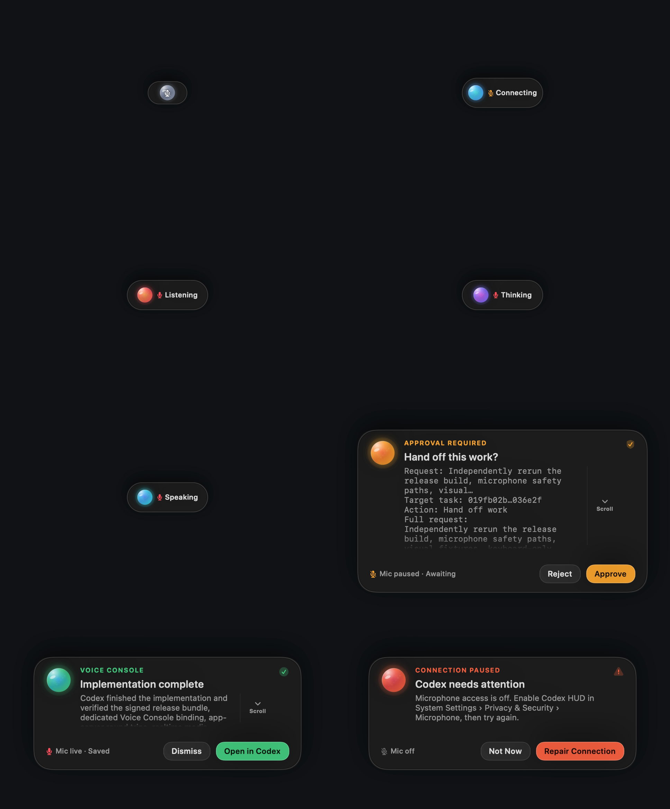

# Codex HUD

Codex HUD is a native macOS voice companion for the official Codex desktop app.
It keeps Codex out of the way while a polished top-centre orb provides one-button
continuous voice control through a dedicated `Voice Console` task.



## Highlights

- Native SwiftUI and AppKit; no Electron runtime.
- Toggle voice with `Shift-Option-Command-Space` or by clicking the orb.
- Continuous listening, spoken replies, and barge-in while Codex is speaking.
- Complete approve/reject cards for commands, permissions, file diffs, and task
  handoffs.
- Uses the signed-in ChatGPT subscription from the official Codex app.
- Never asks for an OpenAI API key or creates separate API billing.
- No audio recording, duplicate transcript archive, or Screen Recording
  dependency.
- Fails closed across lock, display sleep, authentication loss, protocol drift,
  app-server failure, and stale approval races.

## Requirements

- macOS 15 or later.
- The official Codex desktop app, signed by OpenAI and authenticated with a
  ChatGPT subscription.
- Microphone permission for Codex HUD.
- Accessibility is optional and used only by the explicit **Open Voice
  Console** fallback.

## Build and install

Run the complete release gate:

```bash
./script/quality_gate.sh
```

Build, sign, validate, and install the local release:

```bash
./script/build_and_run.sh --stage --release
open "$HOME/Applications/CodexHUD.app"
```

The installed app is written to `~/Applications/CodexHUD.app`. A matching
portable archive is written to `dist/CodexHUD.app.zip`.

## How it works

Codex HUD launches the `codex app-server` executable bundled inside the verified
official Codex application. It restores or creates one task named
`Voice Console`, verifies Codex-managed ChatGPT authentication, and uses the
experimental realtime WebRTC protocol exposed by the installed app.

All Voice Console and coordinated task turns use:

- `approvalPolicy: "untrusted"`
- `approvalsReviewer: "user"`
- `sandbox: "workspace-write"`

The bridge recognizes an exact allowlist of server requests and rejects protocol
drift during the release gate.

## Privacy and permissions

Microphone capture exists only while Voice Console is active. New media tracks
start muted, approvals require an acknowledged mute barrier, and stop or failure
destroys the hidden WebKit media surface. Codex HUD does not persist microphone
audio or its transient transcript presentation.

Screen Recording and Apple Events are intentionally absent. See
[Build, Permission, and Run Notes](QA/BUILD_AND_PRIVACY_NOTES.md) for the full
integration and privacy boundary.

## Quality

The current release candidate passed:

- 120 Swift tests across 10 suites;
- the nine-part release quality gate;
- strict bundle, signature, archive-equivalence, privacy, and protocol checks;
- deterministic fixtures for all HUD states, accessibility layouts, and
  production orb frames;
- hostile visual, lifecycle, approval, and protocol review with no Critical or
  Major source or fixture findings.

See [Release Candidate Report](QA/FINAL_RELEASE_REPORT.md) and
[Release Acceptance Protocol](QA/RELEASE_ACCEPTANCE.md).

## Compatibility note

The subscription-authenticated realtime app-server surface is experimental.
Codex updates can change it. `script/validate_app_server_protocol.sh` derives and
checks the installed protocol schema so incompatible versions fail visibly
instead of silently degrading.
